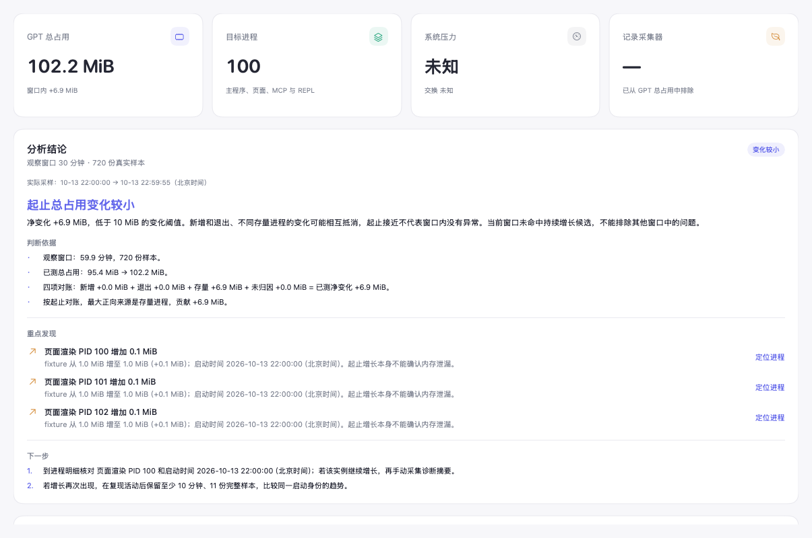

# GPT Manager

macOS 上独立运行的 ChatGPT / Codex 内存观察器与 Codex 会话查看器。提供原生 SwiftUI 桌面应用 GPT Manager 和保留的 `gpt-mem` CLI，记录进程内存，并根据历史给出变化结论、主要来源、重点进程和下一步检查建议。桌面还可在本机查看、搜索 Codex 会话和统计日志记录的 Token 用量。常规内存采样不读取聊天正文；会话模块只在打开该页面后读取本机会话日志，不发送正文或读取其他应用的凭据。AI 内存分析仅在你确认发送摘要后调用所选服务。

[](https://github.com/nothingzhl/gpt-mem/actions/workflows/ci.yml)
[](LICENSE)

[下载发布版本](https://github.com/nothingzhl/gpt-mem/releases) · [安装与发布说明](docs/releases.md) · [贡献指南](CONTRIBUTING.md) · [私密安全报告](SECURITY.md)

桌面 ZIP 按 Apple Silicon（arm64）与 Intel（x86_64）分别提供；解压后将 GPT Manager.app 放入 Applications。CLI 压缩包解压后将 gpt-mem 复制到自己的 PATH 目录。当前产物为 ad-hoc 签名，未经过 Apple 公证，首次启动可能被 Gatekeeper 拦截；确认来源可信后按系统提示操作，不要全局关闭安全检查。



截图使用 scripts/check-page-performance.py 的模拟 fixture，不包含真实会话或用户进程。

需要 macOS 14 或更新版本；从源码构建需要 Swift 6 工具链（Command Line Tools 即可，无需安装完整 Xcode）。采样使用 macOS 原生进程接口，数据保存在本机 SQLite，应用运行不依赖 Python、Node 或第三方包。桌面监控和 CLI `watch` 使用同一套历史及单实例锁。

## 里程碑与后续方向

`milestone-v0.5.2` 保留内存分析、多来源 AI、项目与会话浏览、统计图表，以及性能和整行点击修复。0.6.0 增加通用 AI 报告库，后续模块可以直接复用保存、历史阅读和导出。0.6.1 优化采样和日志读取的临时内存，及时释放已完成或取消的会话任务。0.7.0 增加持久会话摘要索引，重启后复用未变化日志的摘要。0.8.0 增加项目和会话收藏、本地会话名称及备注。0.9.0 增加项目标签、标签筛选及标签搜索。0.10.0 增加分析发现的进程定位、退出确认和处理效果记录。0.11.0 增加跨会话全文搜索与可编辑的继续工作交接稿。0.12.0 增加共用来源的 AI 会话交接，以及报告历史中的交接稿重用。0.13.0 增加共用提示词模板、模块默认选择、临时编辑与报告中的提示词快照。0.14.0 增加应用退出方案。0.15.0 将入口调整为后台工具内存处理，支持进程级筛选、活动提示及新实例检测。0.15.1 增加按需展示启动命令与下级进程命令。0.16.0 增加工作目录与项目依据、按项目归组和同配置多实例排查。0.17.0 增加独立记忆管理：Codex 本地记忆只读浏览、版本化自有记忆库、会话 AI 草稿提取和按范围复用。

后续优先做项目级 AI 分析，把选中的会话与统计汇总成进展、待办和下一步建议，沿用发送前冻结预览；再根据实际整理习惯补会话分组。

## 桌面应用

GitHub Actions 会为 PR 和默认分支运行双架构测试、Release 构建及打包验证，提供桌面 ZIP、独立 CLI、SHA-256 和构建信息。版本标签通过检查后生成草稿 Release；下载与发布步骤见 [CI 与发布产物](docs/releases.md)。版本号统一维护在 `VERSION`。

界面采用 CC Switch 式的左侧栏和主内容区：

- **内存概览**：先看分析结论和检查建议，再查看 GPT 进程合计、观察器自身、系统内存信息和内存变化。
- **进程**：查看所属应用、父子进程、启动身份及内存指标；手动采集诊断、请求退出，并查看处理效果。
- **历史报告**：查看完整的分析结论、判断依据、重点发现和检查建议，以及增长归因和持续增长候选。
- **Codex 工作区**：先看项目卡片和统计图，点击项目进入会话；也可直接浏览、搜索历史对话和工具调用。
- **AI 报告库**：保存成功分析的结论和冻结依据，重启后继续查看，按模块筛选、搜索并导出。
- **设置**：调整采样与存储选项，管理多个 AI 来源、模型和钥匙串密钥。

从项目目录构建并打包：

```sh
./scripts/package-app.sh
./scripts/launch-desktop.sh
```

产物为本项目的 `dist/GPT Manager.app`，也可在 Finder 中双击打开。打包脚本只生成并校验该项目产物，采用本机 ad-hoc 签名；不会自动启动应用、安装到 Applications、启用 launchd 或修改 Codex 配置。重新执行可更新同一产物；运行后的应用使用 macOS 普通应用方式退出。

已有 release 二进制时，可跳过构建，或指定单独构建目录中的产物：

```sh
./scripts/package-app.sh --skip-build
./scripts/package-app.sh --bin /path/to/gpt-manager
```

`--skip-build` 从 SwiftPM 的 release 产物目录读取 `gpt-manager` 和 `gpt-mem`；`--bin` 和 `GPT_MANAGER_BIN` 可指定桌面产物，默认读取同目录的 `gpt-mem`，也可通过 `--cli-bin` 或 `GPT_MANAGER_CLI_BIN` 单独指定。应用内置报告导出程序，无需另行安装 CLI；缺少 CLI 产物时打包会明确报错。不会覆盖本项目之外的路径或目标位置的其他应用。CLI 可继续单独使用和安装。

需要隔离历史数据时，可指定桌面数据目录：

```sh
./scripts/launch-desktop.sh --data-dir "$PWD/desktop-history"
```

也可直接运行应用包中的 `gpt-manager` 并设置 `GPT_MEM_HOME`。未指定时使用下文的默认历史目录；桌面与 CLI 共享同一数据库时遵守同一监控锁。

桌面内存历史使用最多 32 MiB 原始载荷对应的解析缓存，新增样本只解析新记录；其他连接改写数据库时清除缓存，读取窗口与基线仍保持完整。历史未变化时复用本地分析。趋势图同时保留各分段高点和低点；报告与分析使用全部样本。诊断与导出在独立队列运行，采样和暂停不需要等待它们结束。

历史 JSON 按记录回收临时对象，采样和文件操作在每次工作结束时回收临时对象。原生采样只保留各进程所需的紧凑指标，不为每个系统进程额外保留 4 KiB 路径缓冲；采样数据、历史范围和默认采样间隔保持完整。

## 内存操作与效果检查

概览和进程明细提供“内存处理…”入口，只扫描 GPT 应用的后台工具。按项目和工具配置归组，默认展示含至少一个 32 MiB 实例的 MCP、REPL 和工具执行器组，可切换显示低占用组。列表包含所属应用、启动时间、下级进程数与近两分钟 CPU 活动；低 CPU 不代表空闲，缺少数据时明确显示任务状态未知。主应用、Renderer、GPU 和 Codex 后台不在处理列表中，可到进程明细定位和采集诊断。

打开处理窗口时按需读取所列工具的启动命令，并可展开查看每个工具最多 8 个下级进程的命令；最多读取 128 个对象，单条参数上限 16 KiB。读取前后核对启动身份、程序路径和本机用户，只返回 argv，不展示环境变量。读取失败显示未知，超限不展示不完整内容。命令仅保留在当前窗口的临时状态，关闭窗口后清除，不进入采样数据库、操作记录、报告或 AI 输入。可手动刷新；常驻服务的启动参数不代表当前请求内容，低 CPU 和启动命令均不能证明任务空闲。

“按项目分组”将工具归入明确工作项目或“项目归属未知”。项目依据使用已识别工具执行器的明确 `--working-dir` 参数、实际工作目录与已有会话索引中项目路径的最长目录边界匹配（支持无 `.git` 的多仓库工作区），或工作目录所在 Git 仓库；只读既有索引，不扫描原会话日志；索引缺失或不可读时保留 Git/目录依据。插件、技能和应用安装目录不当作工作项目。父进程 PID 与下级命令辅助核对启动关系。当前没有可靠的工具到 Codex 会话映射，因此会话归属仍显示未知，不根据内部 `--session-id` 或公共后台进程猜测。

“同配置多实例”要求相同 GPT 主应用实例、工具类型、可执行程序、完整 argv 和实际工作目录；任何一项读取缺失都不做重复比较。显示组内实例数及这些工具进程的采样 Footprint 合计，不重复计算下级进程。支持“仅同配置多实例”及包含低占用组的筛选；默认保留含至少一个 32 MiB 实例的组及其全部成员，以免隐藏同组低占用对象。多实例可能服务不同会话，不代表多余或空闲；只请求退出人工勾选的进程。

命令和工作目录按需在后台读取，读取前后核对 PID、启动时间、路径和本机用户，权限不足显示未知。项目依据和目录不进入历史、操作记录、报告或 AI 输入；关闭窗口清空临时数据。刷新时清空勾选，避免筛选变化隐藏旧选择。长时间查看后，执行会使用监控的最新样本核对原来选中的启动身份；新实例仍需重新选择，采样已停止且样本过期时拒绝执行。

方案默认不勾选任何对象。确认工具已经不用后，只向选中的进程发送 SIGTERM；可能中断工具任务并影响其下级进程。执行前重新核对身份和 GPT 进程树归属，观察器及其祖先进程、归属仅靠历史记忆、父子链不完整的对象不允许处理。拒绝同时选择父子对象。依次在 1、5、10 秒检查，只有原进程确认退出且未发现同程序新实例才继续下一个；拒绝退出、身份变化、新实例或检查失败均停止后续处理，不自动强杀。“停止后续处理”不撤回已发送的请求。

每个处理对象独立保存操作记录和原实例状态，同程序新实例的 PID 单独列出。界面显示处理期间的已知应用总占用变化，缺测不计算精确差值；其他活动也会影响变化，扫描占用不等于保证释放量。不会调用系统 purge 或修改会话、配置、缓存文件。

分析发现中的“定位进程”跳到当前同一启动身份的进程；旧实例不在当前列表时会提示刷新，不按历史 PID 匹配其他实例。进程详情显示程序路径、所属应用、父进程和直接子进程。

选中目标后可“采集诊断”或“请求退出”。退出确认展示冻结的 PID、程序和启动时间，以及可能中断的任务。应用主进程收到正常退出请求，子进程收到 `SIGTERM`。请求后在 1、5、10 秒检查目标状态及内存；原进程在最终检查中仍存活时，才开放单独的“强制结束”，需要输入目标 PID 并确认，随后发送 `SIGKILL`。不会自动升级到强制结束；工具处理方案只依次请求正常退出。

执行前重新读取应用进程树，并核对目标 PID、微秒启动时间、程序路径及归属；发信号前再次核对本机用户和启动身份。观察器及其父进程、归属仅靠历史记忆的实例、不可确认的实例不能操作。macOS 上身份检查与发信号是两个步骤，无法提供原子性的 PID 绑定保证，因此这里是多次核验而非绝对消除所有竞态。

“诊断与操作记录”区分请求已发送、原实例存活、已退出、PID 已被其他实例复用和状态不可读。新启动的同程序实例单独列出；处理前目标占用与处理后的已知总占用一起展示，缺测时不计算完整变化，也不将其他进程的变化都归因于本次操作。

记录保存在应用数据目录的 `process-actions` 中，目录为 `0700`、JSON 文件为 `0600`。诊断记录包含所选摘要文件位置和采样上下文；退出记录包含处理前后采样和核实状态，两者保存目标最近最多 360 份采样趋势，保留缺测且按启动身份排除复用的 PID。单份最多 512 KiB，界面保留最多 12 份记录；重启读取最多 256 个目录项目中的 12 份最近修改的有效记录，完整文件仍留在本机目录。保存记录失败不会重发已接受的退出请求。应用退出会等待已确认的操作、效果检查和本地保存完成。

## Codex 工作区

左侧“Codex 工作区”默认打开“项目概览”：项目按完整路径分组，同名文件夹不会合并，未记录项目单列。项目卡片显示会话数、工具调用、已知 Token 和最近活动，点击即可查看该项目的会话。“统计图表”提供项目用量排行、会话末次记录模型的分布，以及按北京时间开始日期统计的新会话数量。活跃图最多显示截至最新记录日期的 30 天，不将文件修改时间解释为当天 Token 消费；模型分布统计会话数量，不把整个会话用量归为某个模型的精确消耗。

“会话浏览”提供项目筛选、搜索、归档会话开关和手动刷新。选中会话后查看用户与助手消息、折叠的工具调用与结果、已记录的推理摘要，以及模型、会话 ID 和时间。长对话以 100 条为一页，默认显示最近消息；目录、搜索命中和工具关联跳转会定位到对应页。长消息默认预览前 2000 个字符，可手动展开全文。搜索针对标题、用户提问、项目和会话 ID；助手回答与工具输出不参与跨会话搜索。

默认只读 `~/.codex/sessions` 和 `~/.codex/archived_sessions` 下的 JSONL，并读取 `session_index.jsonl` 中的会话标题；设置 `CODEX_HOME` 可指定 Codex 根目录。索引采用摘要解析，读取、搜索和统计都在后台执行；搜索有 250 毫秒防抖，旧请求不会覆盖新筛选。用户目录、工具配对和全文命中在后台建立，翻页与展开消息复用索引。切换会话会取消旧读取，停止其后续扫描与解析。列表摘要校验大小、修改时间、inode 和 ctime；详情使用最近 3 份、最多 8 MiB 的缓存，相同大小与修改时间的文件替换也会更新。目录读取预算不足时，下一次刷新从有界断点继续；文件变更后重新解析。内存采样不会重绘整份会话。索引中的改名优先于会话内标题，单独改名后刷新即可更新。大文件、过长单行、截断日志和缺失字段会显示限制说明。不会解析或解密隐藏的推理密文。

会话页默认将统计收为一行，可展开查看详细 Token。目录、统计、工具消息及 AI 设置中的折叠入口都支持点击整行，包含标题和右侧空白，点击高度至少 32 点。翻页控制固定在正文区域外，前后页连续且不重叠；同一会话刷新后会校正到有效页面。`Command-R` 刷新当前工作区，会话页刷新 Codex 目录，内存页刷新采样和历史。

日志读取按 64 KiB 分块、逐条解析并回收临时对象，跨块正文和预算续读保持完整。目录、详情和搜索任务完成或取消后释放任务句柄，避免继续保留旧结果；当前展示数据与有界缓存仍可使用。

桌面将摘要索引保存在应用数据目录的 `session-index` 中，以加快再次打开。索引包含会话标题、项目、用量、原解析提示，以及有界的用户提问搜索内容；不保存完整正文、助手回答、工具输出或密钥。缓存目录权限为 `0700`，文件为 `0600`。每份索引最多 16 MiB、2,000 条；未能缓存的摘要继续从原日志读取，不会移除会话。

项目卡片与会话行的星标可添加或取消收藏；星标与打开会话的点击区域独立。收藏优先排列。项目列表可只看收藏，该开关只筛项目列表，统计卡片仍包含全部匹配会话；“会话仅显示收藏”会筛会话及对应统计。项目卡片可以在 Finder 中显示现有目录，同名项目按完整路径区分。

项目卡片提供标签编辑，可用英文逗号、中文逗号或换行分隔，例如 `工作, 学习, 工具`。每个项目最多 8 个标签，每个标签最多 20 字、256 字节；忽略空标签，大小写重复标签只保留一份。标签保存在本机管理数据中，同名项目仍按完整路径分别管理；也可为未记录路径的项目分组添加标签。

“项目标签”筛选同时作用于项目列表、会话和统计，与搜索、项目、收藏和归档条件共同生效；搜索也匹配会话所属项目的标签。移除正在筛选的最后一个标签后保留筛选条件，显示空结果，可手动清除筛选。标签编辑只保存标签字段，保留其他实例最新的收藏和备注；同时修改标签时提示冲突，草稿不会自动覆盖最新值。

会话菜单与详情提供“本地名称与备注”。名称留空并保存即可恢复日志原名；有本地名称时详情也显示原名。搜索可跨原内容、本地名称和备注匹配多个词。管理信息保存在应用数据目录的 `session-management` 中，按来源目录隔离，使用 `0700` 目录和 `0600` 文件；不会改写 Codex 日志、标题索引或用量。每份文件最多 2,000 条、512 KiB；名称最多 120 字，备注最多 4,000 字。

收藏、名称和备注在重启后保留；有日志会话 ID 的会话归档后仍保留管理信息，缺少 ID 的日志按完整文件路径区分。保存失败保留已保存信息和草稿，可重试；取消编辑会丢弃该草稿及其重试。损坏的管理文件不会被自动清空。多实例保存时合并其他项目或字段的最新信息；同字段变更冲突会提示，编辑器可“合并最新管理信息”后再保存。应用退出时等待正在进行的本地管理保存。

每次打开仍检查原日志的身份、大小和纳秒时间戳，追加、同大小改写、删除或归档移动都会更新；改名索引独立读取。读取期间日志发生变化时显示提示，该结果不作为可复用索引保存。不同来源目录、解析版本和限制分开保存；损坏或不可用的缓存自动退回扫描原日志。索引只保存完成的可复用摘要，预算续读的中间状态不会被误当作完整结果。`GPTSessionKit` 默认仍只读来源目录；显式传入 `indexDirectoryURL` 才会保存缓存，缓存位置不得位于来源目录内。

Token 来自日志中的用量字段，优先采用最新累计值。缓存 Token 是输入的子集，推理 Token 是输出的子集，均单独显示，不再次加进总量。没有记录的数值显示“未记录”；筛选统计只说明所选会话的已知用量，不等同于账单，也不根据文件修改时间将跨天历史当作今天的消费。会话日志不能证明某一聊天对应哪个内存进程，两个模块各自保留有依据的数据。

这一模块移植了 [Sessions Viewer](https://github.com/jerrywu001/cc-sessions-viewer) 的 Codex 来源解析思路和会话浏览设计，采用本项目的 Swift / SwiftUI 实现。来源协议、统一消息与用量模型位于独立的 `GPTSessionKit` 库中，后续增加其他会话来源可复用桌面浏览层；共用 AI 服务仍由 `GPTAnalysisKit` 管理。当前会话查看、搜索和统计全部在本机执行。授权与来源说明见 [THIRD-PARTY-NOTICES.md](THIRD-PARTY-NOTICES.md)，也随应用包分发。

## CLI 构建和使用

```sh
swift build -c release
.build/release/gpt-mem status
.build/release/gpt-mem watch --interval 5 --duration 60
.build/release/gpt-mem explain --since 30m
.build/release/gpt-mem report --since 2h --output report.html
```

直接打开生成的 HTML 即可查看报告，所有样式均内嵌，不需要网络或外部 CDN。报告优先展示分析结论、依据、重点发现与下一步检查，并包含起止时刻、采样次数、增长归因、角色汇总、进程变化、创建与退出事件、结束时进程明细，以及数据缺失提示。程序路径仅显示文件名，PID 和运行时间仍保留，分享前请检查。

可手动安装到当前用户目录：

```sh
./scripts/install.sh
~/.local/bin/gpt-mem --help
```

脚本默认写入 `~/.local/bin`，不使用 `sudo`。也可指定目标 bin 目录，或通过 `GPT_MEM_BIN_DIR` 指定。不会修改 shell 配置或安装 MCP。

## 命令

| 命令 | 行为 |
| --- | --- |
| `status`（默认） | 即时采样，显示角色数量和占用、前十个高占用进程、观察器自身、系统压力和交换空间；存在历史时与上一份样本比较 |
| `watch` | 持续采样写入 SQLite，同一数据库目录只允许一个监控实例；Ctrl-C 或 SIGTERM 干净退出并释放锁 |
| `explain --since 30m` | 给出最近窗口的分析结论、主要来源、重点进程和检查建议，保留新增、退出、存量与缺失指标对账；缺少两份样本时明确报错 |
| `report --since 2h --output report.html` | 基于历史生成离线 HTML；不指定 output 时显示分析摘要 |
| `diagnose --pid PID --output vmmap-summary.txt` | 对当前可识别的 GPT 目标手动采集有界 `vmmap -summary`；检查进程启动身份，避免 PID 复用 |

统一支持 `--json`、`--db path` 和 `--help`。`watch --json` 每份样本输出一行 JSON（NDJSON）；其他命令输出一个 JSON 对象。错误写入 stderr，退出码非零，stdout 不混入日志。时间文本使用北京时间，JSON 时间为 ISO 8601。

```sh
gpt-mem status --json
gpt-mem watch --json --interval 5 --duration 120 > samples.ndjson
gpt-mem explain --since 2h --json
gpt-mem report --since 2h --output report.html --json > report.json
```

`watch` 不指定 duration 时持续运行。interval 最小 1 秒，duration 为正秒数。睡眠唤醒或一次采样耗时较长时跳过错过的采样点，避免突发补采。`since` 支持秒以及 `s`、`m`、`h`、`d`，例如 `120`、`30m`、`2h`、`7d`。

## 内存口径与分类

主要指标为 `proc_pid_rusage` 返回的 `ri_phys_footprint`（physical footprint），峰值为 `ri_lifetime_max_phys_footprint`。RSS 是辅助指标，不能直接替代 footprint：压缩等内存承担关系可能令两者明显不同。显示单位为 MiB（1024² 字节）和 GiB（1024³ 字节）。合计为本次成功测量的已识别进程 footprint 之和；缺少指标时明确提示，不把缺失值当成零或进程退出，也不应将该合计等同于整机已用内存。

进程使用启动标识与 PID 共同识别，避免 PID 复用。分类同时参考可执行程序、受限的工具标识及父子关系，覆盖 ChatGPT / Codex 主程序、页面 Renderer、GPU、应用服务、Codex 后台、MCP 应用工具、代码审查、MySQL、电脑操作、REPL 和工具执行器。REPL 与 MCP 分开统计；普通 Node 进程不会仅因使用 Node 就被归入 MCP。观察器自身单列，不计入 GPT 合计。

持续增长候选要求同一进程至少持续 10 分钟、至少 11 份完整样本、净增长至少 100 MiB、至少 70% 相邻样本为正增长，且相邻采样间隔不超过 120 秒；只表示需要进一步定位。进程常驻时间长、单次上涨、角色名称相同或父进程仍存在，均不能证明泄漏。当前没有桌面聊天与 MCP 实例的可靠关联接口，会话归属始终显示为“未知”。本版不自动调用 `vmmap`；`diagnose` 仅在明确执行该命令时采集摘要，不转储对象或聊天内容，默认最多等待 10 秒、输出上限 512 KiB，拒绝覆盖已有文件。超时或部分输出时返回退出码 2，不结束 GPT 目标进程。

## 分析解读

桌面概览、历史页、CLI 与 HTML 报告使用同一份本地分析解读；JSON 在分析对象的 `explanation` 中保留结论类型、文字结论、依据、发现和下一步建议。解读根据实际采样生成，不需要模型服务或网络。

分析说明本窗口占用是增长、下降还是起止变化较小，区分新增进程和已有进程的贡献，并指出增长最多的已有进程；新增进程主导时，点名末次占用最大的新增 PID 和程序。起止净变化绝对值小于 10 MiB 时只说明起止变化较小，仍会提示窗口内的进程活动。完整观测中，峰值较起始上涨至少 100 MiB、随后较峰值回落至少 100 MiB 时，会单独指出上涨后回落。持续增长候选和系统压力也会给出具体依据与检查建议。

缺少两份样本或有效时间跨度时明确无法判断；存在缺测时结论标为部分数据，不以总量下降推断正常。对当前持续增长的进程，建议核对 PID 与启动身份后手动采集内存摘要；已退出实例保留其历史发现，避免按复用的 PID 诊断其他进程。结论解释进程指标和变化，无法据此确定具体对象分配原因或确认泄漏。

## AI 深入分析

在桌面“设置 → AI 分析来源”点击“添加来源”，先选 OpenAI、DeepSeek、Ollama 或自定义预设。名称、协议和基础地址自动填好：DeepSeek 还预填默认模型；OpenAI 可填 Key 后点击“拉取模型”选择账号可用模型，Ollama 可拉取本机已安装模型。自定义入口用于兼容服务或网关。常用信息直接填写，协议、JSON 模式、超时和输出 Token 收在“高级设置”中。支持多条配置：

| 接口协议 | 基础地址示例 | 用途 |
| --- | --- | --- |
| OpenAI Responses | `https://api.openai.com/v1` | OpenAI Responses，默认请求 JSON Schema 结构化结果 |
| OpenAI 兼容接口 | `https://api.deepseek.com` | 使用 Chat Completions 协议的服务或网关；兼容性以服务支持的参数为准 |
| Ollama | `http://localhost:11434` | 本机模型，也支持自行配置的 HTTPS 服务 |

基础地址不包含 `/responses`、`/chat/completions` 或 `/api/chat`，程序按协议补充路径。模型可以搜索并从列表选择，也可直接填写 ID；预设和列表不保证模型支持所有分析参数。远程服务使用 HTTPS；HTTP 仅支持本机回环地址。OpenAI 和远程兼容接口需要密钥，本机兼容服务和 Ollama 可不填写。兼容服务不支持 JSON 格式参数时，可在高级设置中关闭 JSON 模式，返回内容仍会通过同一套结构与引用校验。

“拉取模型”仅向表单上显示的服务地址发送模型列表请求，不发送内存摘要，不保存草稿。新输入的 Key 仅随这次请求使用；编辑已有来源时可复用同地址、同协议的已保存 Key，改成其他服务后需重新填写该服务的 Key。切换预设、服务地址或协议会清除尚未保存的 Key。自定义地址旁直接显示接口格式，可选择 Chat Completions、Responses 或 Ollama。取消、关闭表单或改地址后，旧列表请求不能覆盖新表单；服务不支持列出模型时可手动填写。此流程参考 [CC Switch 的预设与模型选择](https://github.com/farion1231/cc-switch/blob/main/docs/user-manual/en/2-providers/2.1-add.md)，模型列表协议参考 [OpenAI Models](https://developers.openai.com/api/reference/resources/models/methods/list)、[Ollama Tags](https://docs.ollama.com/api/tags)，DeepSeek 预设参考[官方快速开始](https://api-docs.deepseek.com/)。

来源配置保存在历史目录中的 `ai-services.json`，文件权限为 `0600`，不包含 API Key。0.19.4 起使用独立凭据引用和跨进程写锁；新 Key 先写入新条目，配置成功切换后清理旧条目，失败不覆盖旧 Key。旧配置可读，首次保存升级为格式 2，旧版应用会拒绝读取新格式。密钥只保存在 macOS 钥匙串。同地址、同协议编辑时留空表示保留已有密钥；换服务时需填入新 Key，或在高级设置中明确清除原 Key，避免把旧密钥沿用到新服务。“清除已保存的密钥”是独立选项；取消编辑不会保存。配置读取失败时禁止覆盖保存，修复文件后可重新读取。编辑、移除前重新核对已保存来源，冲突时保留草稿与密钥并提示重新打开编辑；保存时保留其他新来源。模型列表拉取期间也可保存手填模型，保存成功会取消列表请求。

高级设置的超时限制从发送到完整响应的总时间；服务持续慢速返回字节也会在期限内取消传输。模型列表与 AI 分析均使用这个限制，取消或超时不会自动重试。

概览与历史页提供“AI 深入分析”：先查看来源、模型、实际观察窗口和匿名摘要，再点击“发送摘要并分析”。预览冻结本次输入，采样仍可继续。来源在确认前被修改时需要重新预览，确认时绑定该请求的密钥；不会自动切换来源或重试。请求可取消，但已经发到服务的请求可能已被处理。

发送内容包括窗口、已测总量、原始四项对账、完整性、系统指标、最多 12 个重点进程实例和最多 120 个保留极值的趋势点。输入限制为 128 KiB。进程使用 `p1/p2` 匿名编号，真实 PID、启动身份、完整路径、原始命令行和原始警告文字留在本机；可选活动说明会随摘要发送。不会自动读取或外发 `vmmap` 文件、聊天或其他日志。

AI 返回摘要、证据观察、原因假设、缺少的证据、检查建议和限制。结果必须引用存在的证据编号，针对对象的检查建议只能引用当前可检查对象；这些校验不能保证模型假设正确。界面标明来源、模型和实际窗口，窗口、活动说明或来源变化后保留旧结果并明确标记。分析失败保留本地解读和上次 AI 结果。

新来源默认输出上限为 8192 Token；已有配置不会被自动提高。预览显示实际上限，旧的低上限配置可在发送前点击“提高到 8192 并重新预览”，保留同一份冻结摘要。若服务明确返回长度限制，界面显示本次上限和有效的生成/推理 Token 用量，并提供提高上限后重新预览的入口（最多 16384）；仍需手动确认发送。长度限制也可能与上下文容量有关，提高预算不能保证解决所有情况，可缩短观察窗口。内容限制、服务失败、缺少完成状态分别给出提示，不自动重试，不把截断正文当作完整报告。请求中的报告要求也限制了结论和条目篇幅。

部分模型的输出预算包含推理 Token，尚未生成报告正文就可能用完预算；参见 [OpenAI 推理预算说明](https://developers.openai.com/api/docs/guides/reasoning) 和 [DeepSeek 长度终止说明](https://api-docs.deepseek.com/api/create-chat-completion/)。诊断只展示固定原因与有效数字，不显示服务原始错误文字、推理正文或密钥。

请求缓存在本次应用运行期间最多保留 16 条，按模块、完整输入、服务配置、密钥摘要和实际时间戳区分；退出应用后释放。成功结果另外自动存入本机“AI 报告库”，包括生成时的完整匿名依据和本地对象映射。历史查看与当前分析结果独立，不会自动调用模型或变成跨启动请求缓存。现有 CLI 和 HTML 导出继续提供本地分析解读。

### AI 报告库

从侧栏“AI 报告库”，或概览、历史页 AI 卡片里的“报告库”进入。可以按模块筛选，搜索结论、来源、模型、活动说明和检查建议；选中报告后展开依据，查看生成时的事实。来源后来改名、删除，仍可读取历史快照；报告中的对象状态只代表当时的观察窗口。

报告保存在历史目录的 `ai-reports` 子目录，每份单独一个 JSON，目录权限 `0700`、报告权限 `0600`。不保存 API Key 或完整服务配置。相同缓存结果重复查看不会产生重复报告；损坏的单份记录会保留原文件并提示，其他报告仍可阅读。保存失败保留当前分析和待保存报告，可“重新保存报告”，不会重新请求 AI。保存中的文件操作结束后应用才退出；保存失败的待重试结果仍只在本次运行中保留。

支持导出 Markdown 和 JSON，包含结论、匿名事实、实际窗口和活动说明，排除本地 PID 映射、来源内部编号和请求指纹。导出不会覆盖报告库、AI 配置、内存数据库和锁文件。移除会把文件移入本机 `ai-reports/trash`，本次运行可撤销最近一次移除；缓存结果不会自动恢复已移除记录。回收文件保留在本机。

读取最多扫描 5,000 个目录项目、最近修改的 1,000 份报告、32 MiB JSON，单份上限 512 KiB；达到上限时显示范围说明，不会自动删除报告。加载的报告按生成时间倒序，超限时该子集不保证包含全部历史中的最新生成报告。报告存储、导出和库管理位于通用组件，后续模块可复用。

### 新模块复用

`GPTAnalysisKit` 是独立 Swift 库，不依赖 `GPTMemoryCore`。模块实现 `AIAnalysisModule.makeInput()`，提供领域规则、事实编号、匿名对象和观察窗口，然后调用同一个 `AIAnalysisCoordinator`；来源、HTTP 请求、钥匙串、限额、输出校验和缓存都由通用层处理。

| 部件 | 职责 |
| --- | --- |
| `AIAnalysisModule` / `AIAnalysisInput` | 模块提供脱敏、有限的事实与领域规则；本地标签与外发匿名编号分开 |
| `AIProviderClient` / `HTTPAIProviderClient` | 接入来源协议，不读取内存快照；新协议可实现同一个客户端接口 |
| `AIProviderPreset` / `AIModelCatalogClient` | 服务商预设与模型发现，供各模块的来源设置共用 |
| `AIAnalysisCoordinator` | 校验输入、调用客户端、检查引用、取消处理与缓存 |
| `MemoryAIAnalysisModule` | 内存模块适配器，复用已计算的对账与候选 |
| `DesktopAIModel` / `AIAnalysisCard` | 通用设置、冻结预览、任务状态与结果展示；每个模块可拥有独立展示状态并共享协调器 |

例如后续磁盘模块可以提供 `disk.change` 等事实编号，并复用相同的来源与结果结构；不需要给 HTTP 客户端增加磁盘判断。协议参考：[OpenAI Structured Outputs](https://developers.openai.com/api/docs/guides/structured-outputs?api-mode=responses)、[DeepSeek JSON Output](https://api-docs.deepseek.com/guides/json_mode/)、[Ollama Chat](https://docs.ollama.com/api/chat)。

## 历史与清理

默认数据库位于 `~/Library/Application Support/gpt-mem/history.sqlite3`。`GPT_MEM_HOME` 可覆盖所在目录，`--db` 可指定文件：

```sh
GPT_MEM_HOME="$PWD/local-history" gpt-mem watch --duration 60
gpt-mem watch --db "$PWD/local-history/history.sqlite3" --duration 60
gpt-mem explain --db "$PWD/local-history/history.sqlite3" --since 30m
```

监控每分钟执行历史维护：24 小时内保留每条原始快照，24 小时至 7 天每分钟保留最新一条，超过 7 天删除。查询时会附带窗口之前最近一条基线；报告显示实际起止时刻，不假定刚好落在窗口边界。停止该数据库的所有监控实例后，删除数据库及同名 `-wal` / `-shm` 文件即可清空历史。锁文件可能留在目录中；是否占用取决于操作系统锁状态，文件存在不代表监控仍在运行。不要在监控运行时删除锁文件或数据库，否则可能破坏单实例判断及记录一致性。

原始历史保留本机进程识别信息和内存指标，不包含聊天正文和令牌。输出中的程序路径脱敏为文件名，SQLite 本身仍应按本机诊断数据保管。

单次历史查询最多读取 10000 份快照（含窗口前基线），覆盖桌面每秒采样、2 小时窗口的完整历史，桌面导出与 CLI 使用同一上限。超出时会在读取快照内容前报错，要求缩短观察窗口或 `--since`，避免长窗口报告占用过多内存，不会静默截断或降采样。桌面历史读取失败时保留上次成功读取的曲线与分析，并提示数据可能来自之前的窗口；读取恢复后自动清除历史错误提示。

## 权限与限制

通常无需管理员权限。其他用户的进程、受系统保护的进程或采样途中退出的进程可能不可读，工具会输出警告和不可用 PID；不会为补齐数据请求提权或绕过系统保护。系统压力、压缩或交换指标不可用时显示“未知”。

分类依赖当前桌面应用的进程结构，未来应用升级可能改变工具名称或布局；未识别子进程会保留为其他或未知 Node。总量变化按观察窗口的起止样本计算，中间创建又退出的进程保留为事件，其生命周期占用不会错误加到结束时总量。无历史、样本太少或指标缺失时不声称分析完整。

## 检查

```sh
./scripts/test.sh
./scripts/smoke-cli.sh .build/debug/gpt-mem
swift build --configuration release
python3 scripts/check-desktop-ai.py --render reports/desktop-ai-preview.png
python3 scripts/check-provider-editor.py
python3 scripts/check-desktop-sessions.py --render reports/desktop-sessions-preview.png
python3 scripts/check-desktop-memory.py
python3 scripts/check-process-actions.py --render
python3 scripts/check-report-library.py --render reports/report-library-preview.png
```

`scripts/test.sh` 使用现有 Swift 工具链执行同一套核心与通用 AI 测试；没有完整 Xcode / XCTest 的环境也可执行，不要求安装完整 Xcode。有 XCTest 时也支持 `swift test`。AI 协议测试使用 URLProtocol mock，不调用真实模型，不需要密钥；配置与凭据测试使用临时文件和测试凭据存储。

`scripts/check-desktop-ai.py` 使用现有 Release 产物验证桌面 AI 配置、冻结预览、密钥绑定、取消、失败保留、旧结果提示及输出预算恢复。恢复检查验证原摘要保留、旧配置保护、最大预算与手动重新确认，修改预算不会发起请求。模型与凭据均为模拟数据，不访问真实服务或系统钥匙串；可选的 `--render` 生成离屏界面预览，不启动应用。真实服务需在设置中填写自己的地址、模型和密钥后手动验证。

`scripts/check-provider-editor.py` 使用模拟目录与凭据验证预设、表单隔离、模型选择、取消与重拉、修改来源后旧请求失效及错误恢复，同样不访问真实服务或系统钥匙串。

`scripts/check-desktop-sessions.py` 使用临时 JSONL 和注入的来源验证会话筛选、用量缺失、后台读取、旧请求失效、错误恢复，以及收藏、备注和项目标签的保存与筛选；`--render` 渲染生产界面的模拟预览，包括标签编辑器和较窄窗口。核心测试还覆盖旧版和新版事件、消息去重、工具配对、累计 Token 与读取边界。检查不读取用户的真实对话目录。

`scripts/check-desktop-memory.py` 使用生产采样服务、注入的合成样本和慢速本地导出组件，验证诊断与导出期间采样继续，暂停无需等待文件操作。只使用临时数据库，不运行真实进程诊断或原生采样。

`scripts/check-report-library.py` 使用临时报告与模拟 AI，验证自动保存、重开、筛选、精确依据保留、失败重试、可撤销移除、冻结导出和应用数据保护；可离屏预览真实报告界面。不读取用户配置或真实报告，也不调用真实 AI。

CLI 检查使用临时目录验证无历史失败、参数校验、短时真实采样、NDJSON 格式、单实例锁、退出后的锁释放以及 HTML 报告，不改动默认历史数据库。

## 跨会话搜索与继续工作

会话工作区右上角的「全文搜索」按需读取本地日志，支持所有项目或指定项目、归档开关，以及用户提问、助手回答、工具、报错线索和代码片段筛选。空格分隔的关键词需要在同一条消息中全部命中。点击整条结果可定位原始消息。此入口独立于原有摘要搜索，最多保留 200 条命中，扫描预算 128 MiB；来源日志本身仍受读取限制，无法读取或截断时会提示结果可能不完整。报错和代码筛选是文本特征匹配。

会话详情的「继续工作」从当前已读取日志生成交接稿，包含来源、最近需求、最近助手答复和本地备注，并用关键词提取进展与下一步线索；可编辑、复制或导出 Markdown。目标、已验证结果和下一步由用户确认，助手原文不会自动标为已完成。交接稿不自动发送到模型，也不修改来源日志。

### AI 会话交接

在会话详情打开「继续工作」，选择共用的 AI 来源，点击「从会话摘录生成 AI 交接」。发送前展示冻结的具体消息、补充说明、模型和服务地址。只选首条用户需求与最近 20 条用户/助手消息，每条最多 4000 UTF-8 字节，必要时进一步缩短以满足总输入预算；不读取工具输出、思考记录、本地备注或编辑器的草稿内容。消息正文可能包含代码、路径或隐私信息，来源标识替换不等于正文匿名化，请在预览中核对。

AI 将摘录整理为目标、进展、约束、待确认问题和下一步清单，保留消息证据。生成结果通过共用 `AIAnalysisCoordinator` 与引用校验，独立于内存模块的当前结果。报告和冻结证据保存到已有的本机 AI 报告库，失败不会覆盖上次结果；取消后的旧响应不会保存。关闭交接编辑页可以继续在后台生成，工作区显示进度和保存状态。

生成后点击「载入 AI 交接结果」，可恢复载入前的编辑内容。编辑器中的修改需要复制或导出 Markdown 保存。以后在「AI 报告库」按「会话交接」筛选，选择报告后点击「继续工作」，即可重新编辑、复制，不会再次调用模型。

新模块通过可选的 `AIAnalysisPresentation` 定义报告标题和解释，来源客户端保持通用，旧输入与旧报告仍可读取。模块测试和桌面流程使用临时日志、模拟凭据与模拟模型，不发送真实会话。

### 可复用提示词模板

在「设置 → 提示词模板 → 管理模板」提前保存提示词。预设包含简洁结论、继续开发、阶段复盘、问题排查交接和优先排查内存大头；自定义模板可设为通用、内存分析或会话交接范围。支持新建、编辑、另存、回收和恢复，最多保存 40 个自定义模板（含回收区），每条最多 8 KiB。模板保存在本机私有 `prompt-templates/library.json`，不会写入模型来源或密钥配置。

内存 AI 分析卡和会话交接编辑器都可选择模板，并设置本模块默认模板。模块默认指引始终保留，提示词补充分析重点和写作要求；不能取消证据校验或改变结构化输出协议。「本次提示词」可临时编辑，临时编辑不会覆盖模板；需要复用时另存为新模板。

发送预览展示模板名称、版本及实际提示词；确认使用的是打开预览时冻结的内容。模板修改、默认更换不会改写旧报告或已打开的预览，临时编辑会在报告中标注。报告回看、Markdown/JSON 导出和交接稿都保留当时的提示词。存储损坏会显示错误并禁止覆盖，冲突编辑须重新读取核对。

## 记忆管理（0.17.0）

侧栏「记忆管理」提供两类来源：

- **Codex 本地记忆**：默认读取 Codex home 下的 memories 目录，可选择其他已有目录；全文搜索已读取的 Markdown，导入独立副本后审核。源文件不修改，历史指令不执行。ChatGPT 的云端记忆不在此目录中。
- **我的记忆库**：新建、编辑、停用、归档、恢复、完整版本查看和导出；可选个人通用、项目专用、会话专用。选择同范围两条后审核合并，原条目归档且历史保留。相同正文给出重复提示。

到 Codex 工作区打开会话，再到记忆管理点击「从已打开会话提取」。复用设置中的 OpenAI、兼容接口或 Ollama，以及共用提示词模板。实际摘录先预览再确认发送，最多首条用户消息及最近 20 条用户/助手消息，不发送工具和思考记录；明确没有可靠内容时允许空候选。报告保存到 AI 报告库，候选点击「审核这条草稿」后才进入编辑器，默认待审核；启用需人工选择。未审核结果不会自动写入记忆。

选中记忆后点击「预览并复用所选」，填写目标项目或会话，只有已启用且范围匹配的内容进入参考文本，可复制或导出 Markdown。不会自动注入 Codex，也不声称同步 ChatGPT 记忆。Codex 生成文件的正式控制方式请参考 [官方记忆说明](https://learn.chatgpt.com/docs/customization/memories)。

自有记忆位于应用数据目录的 knowledge-library/library.json，私有权限、原子写入、跨进程锁及完整条目冲突检查。最多 200 条，每条 20 个完整版本，单条正文 32 KiB，总文件 8 MiB；达到上限会拒绝本次保存并保留已有数据，支持导出完整历史。只读扫描最多 2000 个目录项目、256 个 Markdown、单文件 512 KiB、总正文 8 MiB，符号链接跳过，读取不完整时显示提示。参考文本复制/导出上限 128 KiB，不会静默截断。

验证：`./scripts/test.sh --filter Knowledge`，`python3 scripts/check-knowledge.py --render reports/knowledge-preview.png`。所有自动检查只用临时数据，不发送真实 AI 请求、不修改用户记忆。

0.17.1：自有记忆新增回收站。详情页「移入回收站」保留正文、全部版本和原状态；打开「回收站」筛选后可恢复到删除前状态，或确认永久删除单条记忆及其全部版本。回收站内容不参与复用、重复检测和合并。删除及恢复不消耗正文版本额度。永久删除会在明确确认后移除本地记录，不能恢复；可先导出全部版本，之前自行导出的副本不会删除。Codex 原始记忆仍只读。
记忆库会兼容读取 0.17.0 的格式，首次写入升级为格式 2；旧版应用会拒绝读取新格式，以免把回收站内容重新启用。

## Codex 原始记忆管理（0.18.0）

记忆管理 → Codex 原始记忆 → 选择 `MEMORY.md` → 选择顶层列表项 → 编辑或删除 → 预览差异 → 明确确认写入并备份。仅识别以 `- ` 或 `* ` 开始的顶层列表项及其缩进续行，不把代码块中的列表当成记忆；修改一个条目，保留其他正文、标题及换行格式。其他原始文件本版仍只读。

这是直接修改 Codex 文件的手动功能，与导入自有记忆库不同。操作前将整个文件的前后快照保存到应用数据目录的 `codex-memory-backups`，可导出、预览恢复、确认删除备份。最多 20 份备份，达到上限时拒绝新操作而不丢弃旧记录；可先导出后明确删除不需要的备份。失败操作可能留下操作前快照，恢复前需核对。

保存前比较原文、文件身份和纳秒级时间戳，原子替换；文件变化时拒绝覆盖并保留编辑草稿。恢复要求当前文件与操作后快照一致，恢复前也备份。拒绝符号链接、硬链接、非普通文件、超出 512 KiB 的原始文件，以及不安全的备份目录。

Codex 的生成器不使用本工具的文件锁，最终检查与替换之间仍存在很短的并发窗口，请先结束相关记忆生成任务再操作。手动编辑不会同步修改 `memory_summary.md`、raw memories 或历史来源，不能保证后续不会重新生成相同内容；参见 [OpenAI Docs 的记忆说明](https://learn.chatgpt.com/docs/customization/memories)。这不是官方记忆设置接口，也不控制正在运行的会话已经读取的内容。

自动验证只修改临时 fixture：`./scripts/test.sh --filter CodexMemoryEditingTests`，`python3 scripts/check-knowledge.py`。不操作用户真实 Codex 文件。

## 桌面模型速度（0.19.0）

侧栏「桌面模型速度」只读监听 Codex home 下的 `sessions` 日志，接受日志元数据中来源明确为 Codex Desktop／ChatGPT Desktop 的记录，排除 CLI 来源。打开页面每 5 秒增量读取，离开自动停止；可手动暂停、刷新和按日志模型名筛选，展示近 48 小时的区间效率趋势、模型中位数对比及最近区间明细。不会额外发送模型请求、读取凭据、拦截网络或持久化聊天正文。普通 ChatGPT 云端会话尚无本适配器。

**区间输出效率** = 相邻累计输出用量的增量 / 记录间的墙钟耗时。包含工具、思考、网络、调度等待和日志写入延迟；不是纯生成 Token/s。首段用量等待从 task_started 到首个有效用量记录，也不是首字时间；缺少首字／流式生成时间的指标明确显示「未记录」。输出字段可能包含工具调用参数和思考，不等于屏幕可见文字，思考字段单列但不重复加总。模型名是日志声明，不能核验服务端实际路由；模型对比不是同提示词基准测试。

重复累计用量不重复计数，缺失时间、继承计数无首段基线、计数回退或跨模型的首个混合区间不会伪造速度。截断／替换日志重新解析，未结束的 JSONL 末行等到换行后再处理。仅扫描近 3 个日期目录、最近更新的 32 个候选日志，每次最多读取 8 MiB（单文件 2 MiB），单行最多 1 MiB，保留每文件 500 段、页面最多 1000 段。首轮可能需要多轮追赶，会明确显示待读取数量。

验证：`./scripts/test.sh --filter DesktopSpeedTests`，`python3 scripts/check-desktop-speed.py --render reports/desktop-speed-preview.png`。`--live` 可只读查看真实日志的模型名和区间汇总，均不发测速请求。

0.19.1 性能优化：日志按换行边界批量追加，统计无关事件不解析时间戳；速度明细采用懒加载，同一次页面绘制只筛选一次数据，未变化的统计快照不重复发布。临时日志基准可用 `python3 scripts/check-desktop-speed.py --benchmark` 复现：本机约 12 MiB 大消息日志三轮追赶中位数由 316 ms 降至 21 ms，空闲刷新约 0.2 ms。数据是日志读取基准，不代表整体应用性能或模型生成速度；不会写入真实会话。分块跨行和超长行后的有效用量由针对性测试覆盖。

0.19.2 完成逐模块性能审计：会话冷解析和全文搜索减少约67–69%，200工具推荐扫描减少约91%，历史分析减少约22%（对应合成负载）。八个主页面已进行原生窗口布局与资源占用测量。复现方法、具体规模与限制见 [性能审计](docs/performance-audit.md)，不会把夹具进程的Footprint当成实际应用内存。

0.19.3 优化实际交互：记忆与会话长文使用原生 TextKit 2 可滚动全文，避免一次布局整篇正文；记忆搜索取消固定等待，缓存搜索索引与条目标题，并按属性观察界面变化。采样复用滑动历史窗口，离开内存页面后继续记录并释放历史分析；重复进程路径共享字符串存储。对应合成负载中，132KB记忆首次布局由7.8秒降至86ms，搜索由169–390ms降至2–4ms，历史元数据物理内存增量减少约68%。完整数据、复现命令及测量边界见 [性能审计](docs/performance-audit.md)。

## 许可证与维护

本项目采用 [Apache-2.0](LICENSE)，保留 [NOTICE](NOTICE) 和 [第三方声明](THIRD-PARTY-NOTICES.md)。这是独立工具，与 OpenAI、ChatGPT 或 Codex 官方没有隶属关系。贡献流程见 [CONTRIBUTING.md](CONTRIBUTING.md)，安全问题见 [SECURITY.md](SECURITY.md)，分支保护和维护规则见 [仓库维护](docs/repository-governance.md)。
